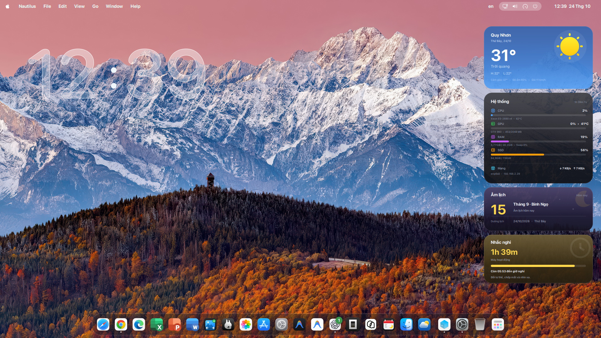
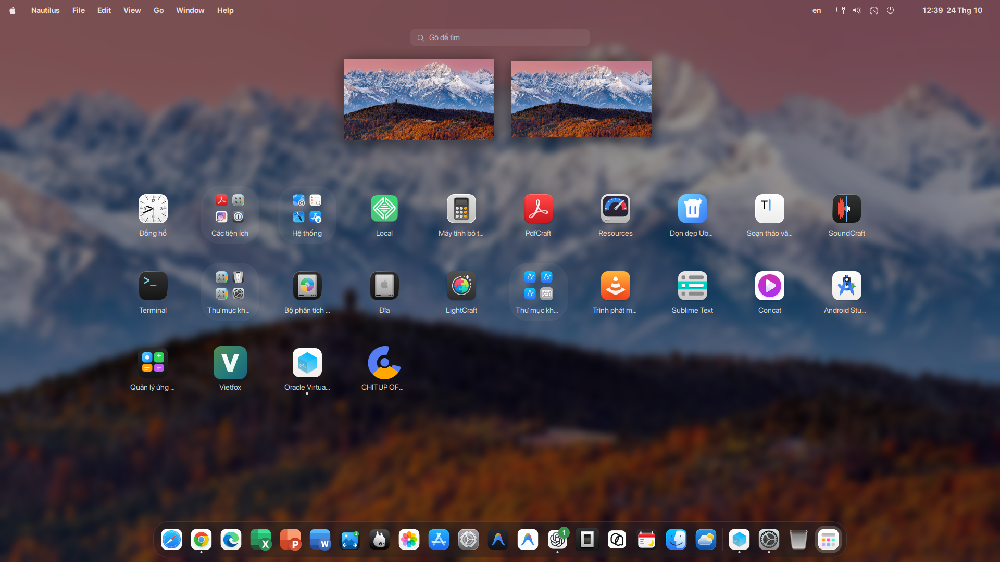
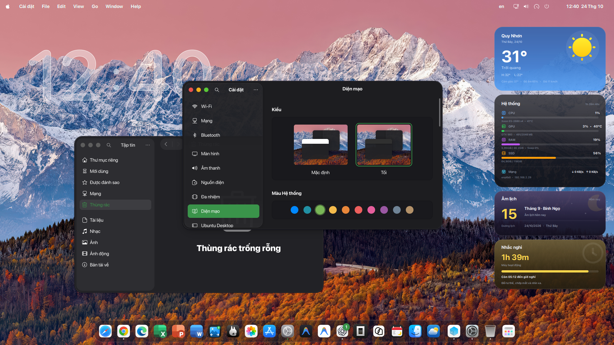

# MacTahoe cho GNOME

Repo cá nhân để đóng gói lại bộ giao diện MacTahoe và các tiện ích đang dùng trên máy.

## Hình ảnh

<p align="center"></p>

<table>
  <tr>
    <td></td>
    <td></td>
  </tr>
</table>

## Nội dung đã gom

- `vendor/MacTahoe-gtk-theme/` và `vendor/MacTahoe-icon-theme/`: snapshot nguồn theme, đã bỏ metadata Git lồng bên trong.
- `assets/fonts/SF-Pro/` và `assets/fonts/SF-Mono/`: font đang dùng.
- `assets/wallpapers/`: wallpaper ngày và đêm.
- `assets/screenshots/`: ảnh giới thiệu desktop, Overview và giao diện ứng dụng.
- `apps/`: launcher điều khiển widget, trình quản lý icon và script lấy dữ liệu.
- `conky/`: cấu hình và Lua cho widget.
- `desktop/`: launcher ứng dụng.
- `config/weather.conf`: vị trí thời tiết hiện tại; chỉnh lại trước khi dùng trên máy khác.
- `vendor/gnome-extensions/`: snapshot các extension người dùng hiện đang bật, gồm Blur My Shell, Global Menu, Just Perfection, Forward Keys và Kimpanel.
- `docs/extension-settings/current-gnome-extensions.md`: các extension đang bật và cấu hình Blur/My Shell, Global Menu trên máy.
- `docs/skin-tahoe-source.md`: hướng dẫn cấu hình ban đầu.
- `config/gsettings.tsv`: tùy chọn GNOME, dock và extension được áp dụng.
- `config/firefox-user.js`: tùy chọn cần cho CSS theme Firefox.

## Trạng thái

Sau khi cài Git, cài bằng một lệnh:

```bash
git clone https://github.com/adfoxtheme/mactahoe-ubuntu.git && cd mactahoe-ubuntu && ./install.sh
```

Lệnh trên cài GNOME Tweaks, Extension Manager, theme GTK/Shell, icon/cursor, font, wallpaper, cấu hình GNOME/dock, các extension, Firefox, widget và trình quản lý icon. GDM được áp dụng ở cuối và cần quyền quản trị; dùng `./install.sh --without-gdm` để bỏ riêng màn hình đăng nhập. Widget chỉ chạy khi mở launcher, không tự bật lúc đăng nhập.

### Sau khi cài

1. Chờ Terminal báo `Installed`, sau đó đăng xuất rồi đăng nhập lại để GNOME nạp theme và extension. Nếu cài theme màn hình đăng nhập trên Ubuntu, khởi động lại máy.
2. Widget không tự chạy khi đăng nhập. Mở ứng dụng **Widget MacTahoe** trong danh sách ứng dụng, hoặc chạy `mactahoe-widgets start` trong Terminal. Tắt widget bằng `mactahoe-widgets stop`.
3. Mở **Quản lý icon MacTahoe** trong danh sách ứng dụng để chọn icon riêng cho ứng dụng. Font và bộ icon/theme tổng thể đã được cài tự động.
4. Nếu không thấy thay đổi, kiểm tra Terminal đã hiện thông báo `Installed` chưa; nếu có, thử đăng xuất/đăng nhập lại một lần nữa.

Chạy `./uninstall.sh` để gỡ theme và ứng dụng, khôi phục file đã sao lưu; script hỏi trước khi khôi phục bản sao cấu hình GNOME. Các gói hệ thống được giữ lại.

`install.sh` nhận diện Ubuntu/Debian (`apt`), Fedora (`dnf`) và Arch (`pacman`), yêu cầu GNOME Shell 48 trở lên. Thiết lập Dock/favorites và theme màn hình đăng nhập chỉ áp dụng cho Ubuntu; theme GDM dùng Yaru nên các hệ khác tự bỏ qua bước này. Trên Debian, Fedora và Arch, script cài phần giao diện/tiện ích chung nhưng chưa áp dụng cấu hình distro-specific. Extension có thể cần bản cập nhật tương thích với phiên bản GNOME đang dùng; GNOME có thể tự vô hiệu hóa extension không tương thích. Sau khi cài cần đăng xuất/đăng nhập lại để nạp extension; nếu cài GDM thì reboot để thấy thay đổi.

## Nguồn và phiên bản theme

- MacTahoe GTK: commit `1e45e19` theo tài liệu cấu hình.
- MacTahoe icons: commit `839848b9` theo tài liệu cấu hình.
- Theme gốc có hướng dẫn và thông tin giấy phép bên trong từng thư mục `vendor/`.

Font SF Pro được đưa kèm trong repo. Hãy kiểm tra điều khoản giấy phép trước khi phân phối lại.
